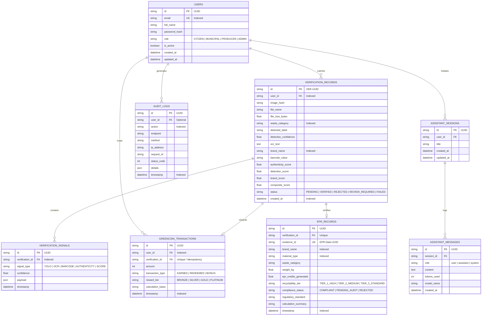

# GreenLoopAI — Database Architecture & ER Design

## 1. Overview
GreenLoopAI employs a normalized relational database schema (PostgreSQL in production, SQLite in local dev) designed for transaction safety, audit integrity, and regulatory compliance under Extended Producer Responsibility (EPR) frameworks.

---

## 2. Entity-Relationship (ER) Diagram

---

## 3. Relational Tables Specification

### 3.1. `users`
* **`id`** (`VARCHAR(36)`): Primary Key (UUID v4).
* **`email`** (`VARCHAR(255)`): Unique, Case-insensitive, Indexed.
* **`full_name`** (`VARCHAR(255)`): User's full legal/display name.
* **`password_hash`** (`VARCHAR(255)`): Cryptographic hash (SHA-256 + salt or Argon2id).
* **`role`** (`ENUM`): `CITIZEN`, `MUNICIPAL`, `PRODUCER`, `ADMIN`.
* **`is_active`** (`BOOLEAN`): Account active status.

### 3.2. `verification_records`
* **`id`** (`VARCHAR(36)`): Primary Key formatted as `VER-[HEX12]`.
* **`user_id`** (`VARCHAR(36)`): Foreign Key references `users(id)`.
* **`image_hash`** (`VARCHAR(64)`): SHA-256 content hash for duplicate-image prevention.
* **`waste_category`** (`VARCHAR(100)`): Primary taxonomy category (Plastic, Cardboard, Metal, Glass, E-Waste).
* **`authenticity_score`**, **`detection_score`**, **`brand_score`**, **`composite_score`** (`FLOAT`): Real computed verification breakdown signals.
* **`status`** (`ENUM`): `VERIFIED`, `REJECTED`, `PENDING`, `REVIEW_REQUIRED`, `FAILED`.

### 3.3. `greencoin_transactions`
* **`id`** (`VARCHAR(36)`): Primary Key (UUID v4).
* **`verification_id`** (`VARCHAR(36)`): Unique foreign key ensuring **idempotent reward allocation** (no double crediting).
* **`amount`** (`INTEGER`): Number of GreenCoins awarded.
* **`reward_tier`** (`ENUM`): `BRONZE`, `SILVER`, `GOLD`, `PLATINUM`.

### 3.4. `epr_records`
* **`id`** (`VARCHAR(36)`): Primary Key (UUID v4).
* **`evidence_id`** (`VARCHAR(100)`): Unique compliance hash `EPR-YYYYMMDD-[HEX8]`.
* **`epr_credits_generated`** (`FLOAT`): Multiplied credit value ($Weight \times Factor \times Quality$).
* **`compliance_status`** (`ENUM`): `COMPLIANT`, `PENDING_AUDIT`, `REJECTED`.

---

## 4. Transactional Safety & Atomicity
Verification workflows execute inside an isolated ACID database transaction:
1. `SAVE verification_records`
2. `SAVE verification_signals`
3. `SAVE greencoin_transactions` (idempotent)
4. `SAVE epr_records`
5. `COMMIT` or `ROLLBACK` on error.
