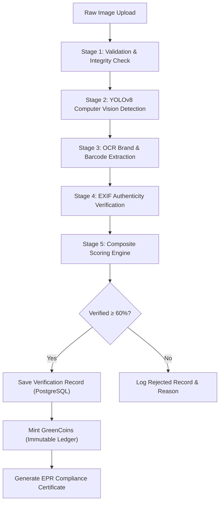

# GreenLoopAI — Multi-Stage Verification Pipeline

## DETECT → VERIFY → REWARD → TRACK → COMPLY

The GreenLoopAI verification pipeline processes raw waste item photographs through five specialized, non-blocking verification stages:

---

## 1. Stage 1: Validation & Integrity Check
* Checks MIME type (`image/jpeg`, `image/png`, `image/webp`).
* Enforces file size limits ($\le 10\text{ MB}$).
* Computes SHA-256 binary hash to detect duplicate re-uploads.
* Converts colour space to RGB using Pillow and normalizes dimensions.

---

## 2. Stage 2: Computer Vision (YOLOv8)
* Runs neural network inference using `models/yolov8n.pt`.
* Detects object classes and maps to circular economy taxonomy (`Paper / Cardboard`, `Plastic`, `Metal`, `Glass`, `E-Waste`, `Textile / Fabric`, `Wood / Bulky`, `Organic / Compost`).
* Generates normalized bounding box coordinates $[x_1, y_1, x_2, y_2]$ and class confidence scores.

---

## 3. Stage 3: OCR Brand & Barcode Recognition
* **EasyOCR Deep Learning Engine**: Scans packaging text, normalizes text candidates, and matches against registered EPR brand registries.
* **OpenCV Barcode & QR Code Engine**: Detects 1D barcodes (EAN-13, UPC-A, Code-128) and 2D QR codes on packaging.
* Unbranded recyclable materials receive standard circular economy baseline qualification ($55\%$).

---

## 4. Stage 4: Authenticity & Provenance Verification
* Analyzes EXIF metadata, camera make/model, ISO, aperture, software tags, and temporal timestamps.
* Distinguishes between direct camera captures vs digital screenshots/synthetic images to prevent fraudulent submissions.

---

## 5. Stage 5: Composite Scoring & Reward Allocation
Composite score formula:
$$\text{Composite Score} = (S_{\text{detection}} \times 0.45) + (S_{\text{brand}} \times 0.30) + (S_{\text{authenticity}} \times 0.25)$$

* **Verification Threshold**: Score $\ge 60.0\%$ with detected recyclable material.
* **GreenCoins Rewards**: Base coins $= \text{Composite Score} \times 0.5$ + Tier bonuses + 15 EPR Brand Bonus coins.
* **Atomic Ledger Transaction**: Saves verification, audit signals, GreenCoins transaction, and EPR record in a single ACID commit.
